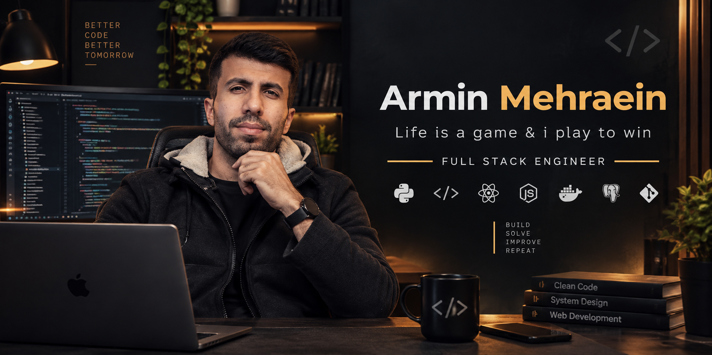

## About Me 👋

I'm Armin Mehraein, a Full Stack Developer with a strong focus on mobile and web development. My expertise spans across multiple technologies and domains, making me a versatile developer capable of handling complex projects from end to end.

## Skills & Expertise 🛠️

### Mobile Development 📱
- Flutter (Cross-platform mobile development) | Kotlin (Native Android development)

### Web Development 🌐
- Backend: Laravel | Django | Flask
- Frontend: React | Vue.js

### IoT & AI 🤖
- IoT Platform Development
- Artificial Intelligence Implementation
- Smart Device Integration
- AI-powered Solutions

### Full Stack Capabilities 💻
- End-to-end application development
- System architecture design
- Database management
- API development and integration
- Cloud services implementation

## Professional Focus 🎯

I specialize in creating robust, scalable applications with a particular emphasis on:
- Mobile-first development
- Cross-platform solutions
- IoT integration
- AI implementation
- Modern web applications

## Contact 📫

Feel free to reach out to me for collaborations or opportunities!

